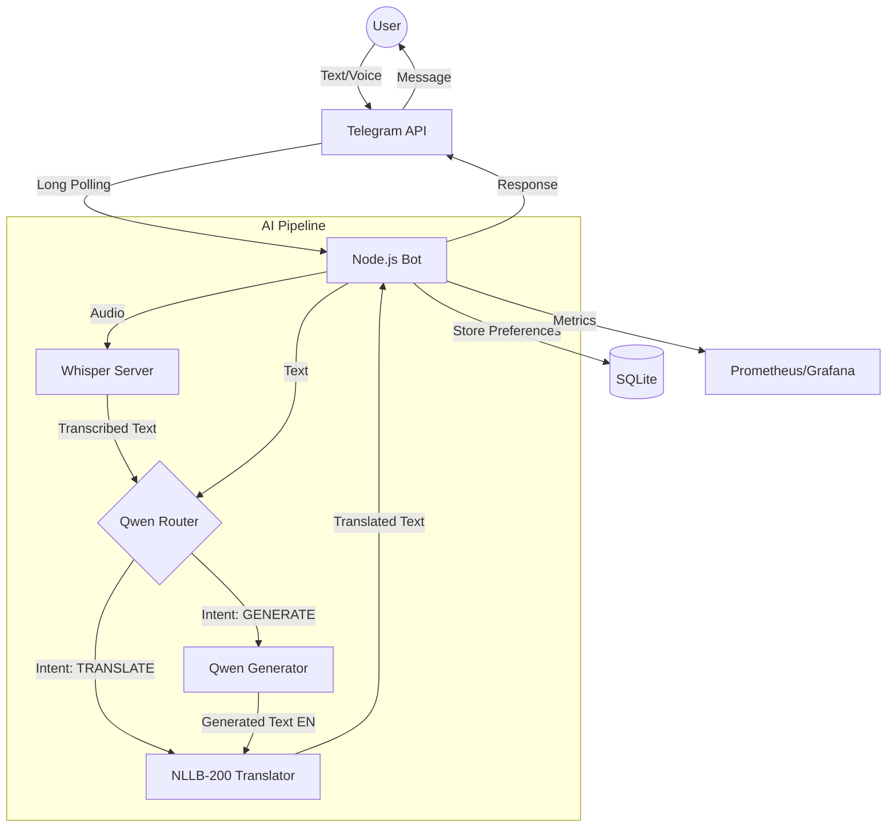

# Claptrap Bot

AI-powered Telegram bot with voice recognition, translation, and text generation capabilities.

## Architecture



## Features
- **Voice/Audio transcription**: Uses Whisper small for high-quality speech-to-text.
- **Smart Routing**: Qwen 2.5 detects intent (Translate vs Generate) and languages.
- **Multi-language support**: NLLB-200 handles translation between 30+ strictly supported languages.
- **Native-Language Optimization**: Generates content in Qwen's native language (English) for better quality, then translates back.
- **User Preferences**: Remembers target language via `/lang` command.
- **Monitoring**: Built-in Prometheus metrics for Grafana.
- **Security**: Input validation via Zod and prompt injection protection.
- **Stability**: Concurrency limiting using p-limit to protect AI hardware.

## Tech Stack
- **Runtime**: Node.js 26+ (LTS)
- **Language**: TypeScript 5.x
- **Bot Framework**: Telegraf
- **Database**: SQLite with Drizzle ORM
- **AI Services**: Whisper, Ollama (Qwen 2.5), NLLB-200
- **Logging & Metrics**: Pino, Prometheus Client, Express

## Setup

1. **Install dependencies:**
   ```bash
   npm install
   ```

2. **Configure environment:**
   Copy `.env.example` to `.env` and fill in your details:
   ```bash
   cp .env.example .env
   ```
   - `BOT_TOKEN`: Get from @BotFather
   - `AI_SERVER_URL`: Your local AI server address (e.g., http://192.168.0.100)
   - `API_KEY`: Your AI server API key

3. **Initialize Database:**
   ```bash
   npx drizzle-kit generate
   npx drizzle-kit migrate
   ```

4. **Run in development mode:**
   ```bash
   npm run dev
   ```

5. **Build for production:**
   ```bash
   npm run build
   npm start
   ```

## Metrics
Metrics are available at `http://localhost:3000/metrics` for Prometheus/Grafana integration.
